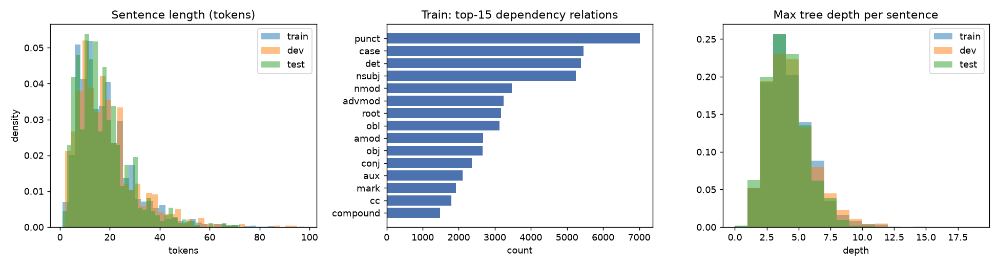
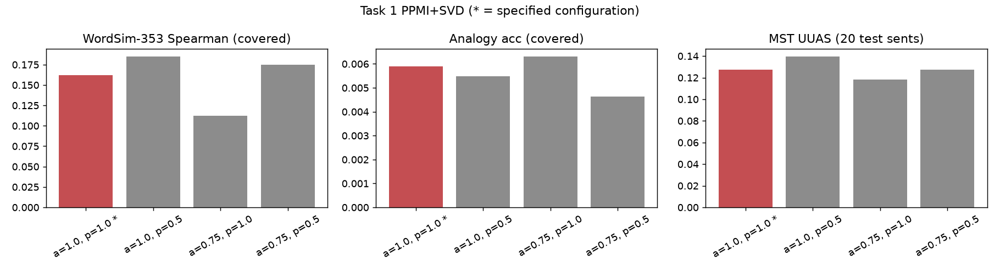
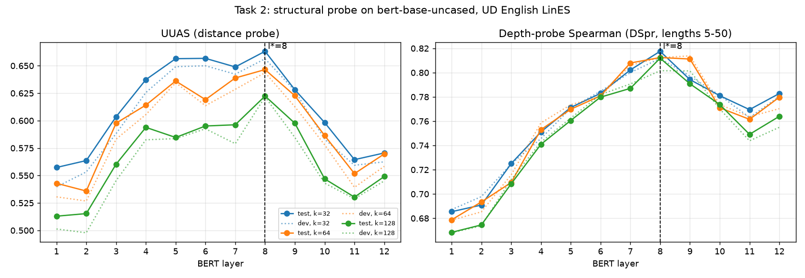
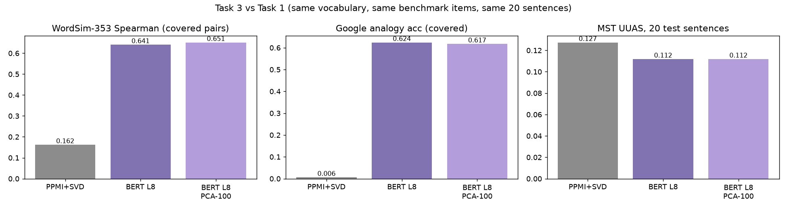
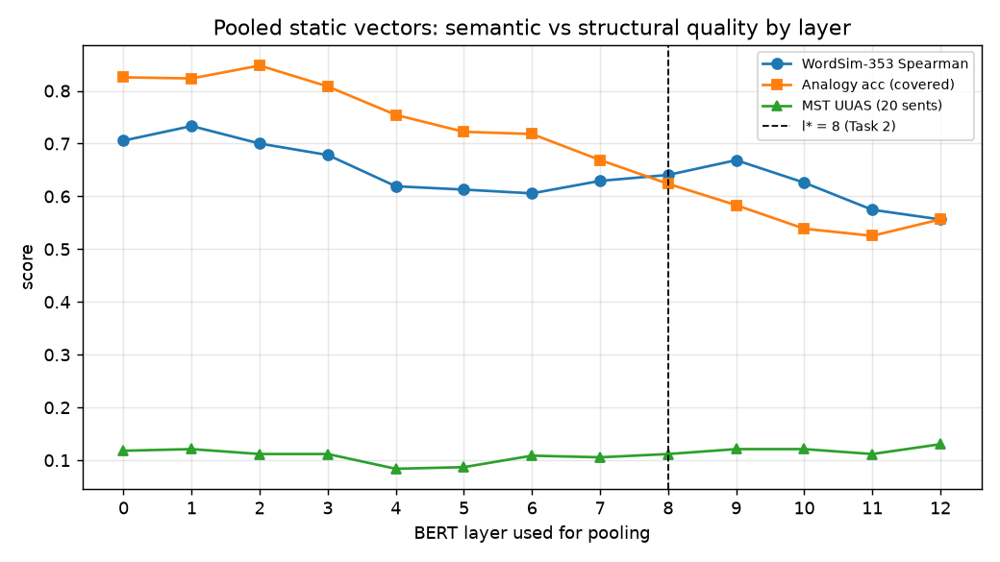

# Project 5 - From Static to Contextual: results on UD English LinES

Data source: `ud-github-r2.7`

| split | sentences | tokens | types_lowercased | len_mean | len_max | non_projective | sentences_also_in_train |
|---|---|---|---|---|---|---|---|
| train | 3176 | 57372 | 7606 | 18.0642 | 98 | 250 | nan |
| dev | 1032 | 19170 | 3918 | 18.5756 | 95 | 102 | 2.0000 |
| test | 1035 | 17675 | 3669 | 17.0773 | 72 | 65 | 3.0000 |

## Task 1 - PPMI + SVD

Vocabulary 7606 lower-cased types from 57372 train tokens; window +/-5, PPMI alpha=1.0, SVD 100d.

| Metric | Value |
|---|---|
| WordSim-353 Spearman (covered pairs) | 0.1621 (116/353 pairs) |
| WordSim-353 Spearman (all 353, OOV sim = 0) | -0.0424 |
| Google analogy accuracy (all 19,544, OOV = wrong) | 0.0007 |
| Google analogy accuracy (covered) | 0.0059 (2374 questions) |
| MST UUAS vs gold, 20 test sentences | 0.1273 (41/322 edges) |
| - linear-chain baseline / random-tree baseline | 0.4348 / 0.1184 |

Ablation (PPMI smoothing alpha x SVD weighting power):

| alpha | svd_power | main | ws353_spearman_covered | ws353_spearman_all353 | analogy_acc_all | analogy_acc_covered | struct_uuas |
|---|---|---|---|---|---|---|---|
| 1.0000 | 1.0000 | True | 0.1621 | -0.0424 | 0.0007 | 0.0059 | 0.1273 |
| 1.0000 | 0.5000 | False | 0.1852 | 0.0333 | 0.0007 | 0.0055 | 0.1398 |
| 0.7500 | 1.0000 | False | 0.1126 | -0.0543 | 0.0008 | 0.0063 | 0.1180 |
| 0.7500 | 0.5000 | False | 0.1747 | 0.0053 | 0.0006 | 0.0046 | 0.1273 |

## Task 2 - Structural probe on bert-base-uncased

Best layer **l\* = 8** (selected on dev UUAS). Test-argmax layers: UUAS 8, depth Spearman 8.

Per layer (max over ranks):

| layer | dev_uuas | test_uuas | test_uuas_best_dev_rank | dev_depth_spearman | test_depth_spearman | test_root_acc |
|---|---|---|---|---|---|---|
| 1 | 0.5396 | 0.5573 | 0.5573 | 0.6871 | 0.6854 | 0.5237 |
| 2 | 0.5533 | 0.5636 | 0.5636 | 0.6978 | 0.6934 | 0.5034 |
| 3 | 0.5881 | 0.6035 | 0.6035 | 0.7247 | 0.7250 | 0.5179 |
| 4 | 0.6256 | 0.6373 | 0.6373 | 0.7586 | 0.7530 | 0.5314 |
| 5 | 0.6491 | 0.6564 | 0.6564 | 0.7736 | 0.7713 | 0.5507 |
| 6 | 0.6500 | 0.6567 | 0.6567 | 0.7847 | 0.7829 | 0.5217 |
| 7 | 0.6423 | 0.6489 | 0.6489 | 0.8060 | 0.8079 | 0.6193 |
| 8 | 0.6563 | 0.6632 | 0.6632 | 0.8124 | 0.8176 | 0.6058 |
| 9 | 0.6272 | 0.6281 | 0.6281 | 0.8138 | 0.8112 | 0.5546 |
| 10 | 0.5831 | 0.5982 | 0.5982 | 0.7813 | 0.7810 | 0.4937 |
| 11 | 0.5593 | 0.5644 | 0.5644 | 0.7637 | 0.7695 | 0.4551 |
| 12 | 0.5625 | 0.5705 | 0.5705 | 0.7803 | 0.7828 | 0.5314 |

All runs: `task2/probe_results.csv`.

## Task 3 - BERT-derived static vectors vs PPMI+SVD

| model | ws353_spearman_covered | ws353_n_covered | ws353_spearman_all353 | analogy_acc_all | analogy_acc_covered | analogy_n_covered | analogy_sem_covered | analogy_syn_covered | struct_uuas_20 |
|---|---|---|---|---|---|---|---|---|---|
| Task 1: PPMI+SVD (100d) | 0.1621 | 116 | -0.0424 | 0.0007 | 0.0059 | 2374 | 0.0368 | 0.0032 | 0.1273 |
| Task 3: BERT L8 mean-pooled (768d) | 0.6406 | 116 | 0.0084 | 0.0758 | 0.6238 | 2374 | 0.8263 | 0.6062 | 0.1118 |
| Task 3: BERT L8 + PCA (100d) | 0.6512 | 116 | 0.1391 | 0.0750 | 0.6171 | 2374 | 0.7053 | 0.6094 | 0.1118 |

- WordSim paired bootstrap: delta +0.4786, 95% CI [+0.2573, +0.6870]
- Analogy McNemar: only-PPMI-correct 0, only-BERT-correct 1467, p = 0
- Structural (per-sentence Wilcoxon): BERT better on 3, worse on 7, tied 10; p = 0.333

Layer sweep of pooled vectors:

| layer | ws353_spearman | analogy_acc_all | analogy_acc_covered | analogy_sem_covered | analogy_syn_covered | struct_uuas |
|---|---|---|---|---|---|---|
| 0 | 0.7057 | 0.1003 | 0.8256 | 1.0000 | 0.8104 | 0.1180 |
| 1 | 0.7333 | 0.1000 | 0.8235 | 0.9947 | 0.8086 | 0.1211 |
| 2 | 0.7001 | 0.1030 | 0.8479 | 0.9789 | 0.8365 | 0.1118 |
| 3 | 0.6784 | 0.0982 | 0.8083 | 0.9632 | 0.7949 | 0.1118 |
| 4 | 0.6192 | 0.0916 | 0.7544 | 0.8474 | 0.7463 | 0.0839 |
| 5 | 0.6129 | 0.0878 | 0.7224 | 0.8211 | 0.7138 | 0.0870 |
| 6 | 0.6057 | 0.0872 | 0.7182 | 0.8316 | 0.7083 | 0.1087 |
| 7 | 0.6293 | 0.0813 | 0.6689 | 0.8263 | 0.6552 | 0.1056 |
| 8 | 0.6406 | 0.0758 | 0.6238 | 0.8263 | 0.6062 | 0.1118 |
| 9 | 0.6686 | 0.0709 | 0.5834 | 0.7421 | 0.5696 | 0.1211 |
| 10 | 0.6260 | 0.0654 | 0.5388 | 0.6737 | 0.5270 | 0.1211 |
| 11 | 0.5746 | 0.0638 | 0.5253 | 0.6895 | 0.5110 | 0.1118 |
| 12 | 0.5563 | 0.0676 | 0.5564 | 0.6684 | 0.5467 | 0.1304 |

### Discussion (generated from the numbers above)

- WordSim-353 Spearman: BERT-L8 0.6406 vs PPMI 0.1621 (higher, delta +0.4786; statistically significant, p=0).
- Analogy accuracy (covered): BERT-L8 0.6238 vs PPMI 0.0059 (higher, delta +0.6179; statistically significant, p=0).
- Structural MST UUAS (20 sents): BERT-L8 0.1118 vs PPMI 0.1273 (lower, delta -0.0155; not statistically significant, p=0.333).
- The two kinds of evaluation do not fully agree: the semantic benchmarks and the structural check rank the two models differently.
- Across pooled layers, WordSim-353 peaks at layer 1 and the static-vector MST check peaks at layer 12; the probe-selected layer is 8.

Interpretation guide: WordSim-353 and analogies test semantic/lexical structure; the MST check tests whether cosine geometry of type-level vectors mirrors syntactic attachment. Averaging over contexts removes the token-specific information the probe exploits, so a gain on one evaluation need not carry over to the other.
